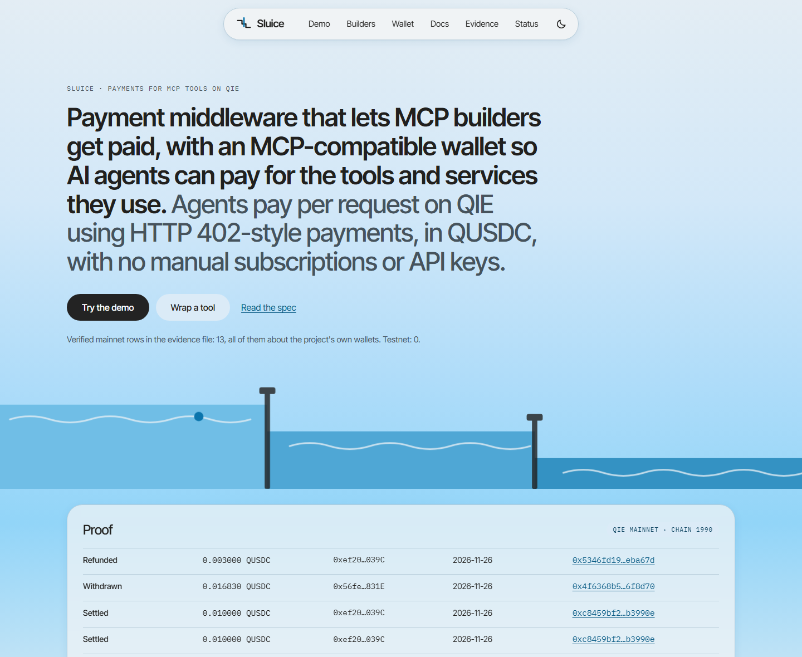
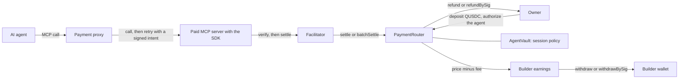
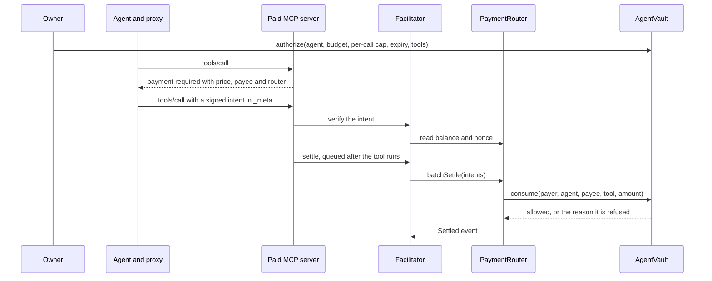

# Sluice

<p align="center"></p>

Payment middleware that lets MCP builders get paid, with an MCP-compatible wallet so AI agents can pay for the tools and services they use. Agents pay per request on QIE using HTTP 402-style payments, in QUSDC, with no manual subscriptions or API keys. This repository holds an SDK for MCP servers, a facilitator, a payment proxy and a wallet MCP for agents, the contracts behind them, a web app, a written spec, and the tooling that checks every public claim against the chain. It has been tested on a local copy of QIE mainnet. The contracts are deployed on QIE mainnet, and [the evidence file](docs/EVIDENCE.md) holds rows for the deployment, the router's source, a deposit, a start with no QIE, three paid calls settled in batches, two withdrawals and a refund. All of it is founder-run, and all of those rows are about the project's own wallets: 0 paid calls by anyone outside the project. It holds no row for a hosted service. The web app is written for real use on QIE (chain 1990, real QUSDC): its demo opens on a real payment from your own wallet, and the simulation is a separate tab that says it is one. Until it is given the contract addresses, a facilitator and a tool server, it says what is missing and shows nothing in their place.

## Contents

- [The problem](#the-problem)
- [What it does](#what-it-does)
- [How it works](#how-it-works)
- [Architecture](#architecture)
- [The pay flow](#the-pay-flow)
- [For MCP builders](#for-mcp-builders)
- [For agents](#for-agents)
- [The example paid tools](#the-example-paid-tools)
- [Web app](#web-app)
- [What the owner can and cannot do](#what-the-owner-can-and-cannot-do)
- [What QIE provides](#what-qie-provides)
- [How this differs](#how-this-differs)
- [Current status](#current-status)
- [Evidence](#evidence)
- [Safety and tests](#safety-and-tests)
- [Quick start](#quick-start)
- [Going live](#going-live)
- [Environment variables](#environment-variables)
- [Repository layout](#repository-layout)
- [Built for the QIE Hackathon](#built-for-the-qie-hackathon)
- [License](#license)

## The problem

An AI agent that needs a tool at run time has no good way to pay for it, and an MCP builder has no good way to charge.

- A monthly plan and an API key need a human to sign up first.
- A card payment has minimums and fees that make a price of a fraction of a cent impossible.
- One on-chain transfer per call means a wallet signature and a transaction for every call.
- An agent holding a wallet key with no limit can spend everything it can reach.
- The MCP specification has no payment step, so each builder has to invent one.
- The usual x402 payment on an EVM chain needs a token that supports EIP-3009 or Permit2. QUSDC supports neither, and QIE has no Permit2 contract. [docs/SPEC.md](docs/SPEC.md) explains the scheme Sluice uses instead.

## What it does

A builder puts a price on an MCP tool. An agent's call without payment is answered with the price, in the x402-over-MCP message format. The agent's payment proxy checks the price against a budget the owner set, signs an intent, and retries. The builder's server verifies it, runs the tool and queues the payment. A facilitator settles many payments in one transaction.

| Principle | What it means |
| --- | --- |
| Per-call prices | A tool has a price in QUSDC and a payee. A call without payment gets the price and nothing else. |
| Prepaid | The payer deposits QUSDC into the router once. The balance belongs to the payer until a signed call spends it, and the payer can take back the unspent part at any time. |
| Signed intents | A payment is an EIP-712 message with payer, payee, amount, tool, nonce and deadline. It is bound to the chain and the contract, it expires, and it works once. |
| Idempotent | The same intent never charges twice or runs a tool twice. A tool that fails is not charged. |
| Anyone can settle | The signature authorises the payment, not the person who submits it. A facilitator pays the gas for a batch. |
| Capped fee | The fee comes out of the builder's side and can never be set above 2%. The payer always pays exactly the signed amount. |
| Limits for agents | The owner gives an agent key a budget, a cap per call, an expiry and a list of allowed tools. The proxy refuses early, and the AgentVault enforces the same limits on chain. An agent cannot raise its own budget. |
| No admin over funds | The owner can change the fee (within the cap) and the fee recipient, and nothing else. There is no proxy contract and no pause. |
| Start without QIE | A wallet that holds QUSDC and no QIE can deposit and authorise an agent by signing. The facilitator sends the gas. |
| Leave without QIE | A builder or payer with no QIE can withdraw or refund by signing a request that a relayer submits. |

## How it works

An agent reaches a paid tool through its proxy. The server answers with a price, the proxy signs inside the owner's budget, and the payment is settled in a batch. Money sits in the router and moves between two numbers inside it. QUSDC leaves only when a builder withdraws or a payer refunds.



A call made by an agent key is checked against the owner's policy inside the same transaction that settles it.



## Architecture

| Part | Path | What it does |
| --- | --- | --- |
| Public spec | `docs/SPEC.md`, `docs/spec-vectors.json` | The Sluice payment scheme for MCP on QIE, written to be implemented by someone else, with test vectors from throwaway keys. |
| SDK | `packages/sdk/src/paid-tool.ts`, `packages/sdk/src/protocol.ts`, `packages/sdk/src/x402.ts` | `paidTool` middleware, the EIP-712 intent and its checks, and the x402-over-MCP messages. |
| SDK client side | `packages/sdk/src/facilitator-client.ts`, `packages/sdk/src/onboarding.ts`, `packages/sdk/src/authorize.ts` | The facilitator's HTTP client, and signing for the start with no QIE and for agent sessions. |
| Facilitator | `packages/facilitator/src/service.ts`, `packages/facilitator/src/server.ts` | The verify, settle, status, onboard and relay endpoints, queueing, and `batchSettle` with `SettleSkipped` handling. |
| Relayer and caps | `packages/facilitator/src/relayer.ts`, `packages/facilitator/src/caps.ts` | The one hot key behind hard limits in code: gas, gas price, a daily QIE budget, a destination allowlist and per-day limits. |
| Payment proxy | `packages/proxy/src/proxy.ts`, `packages/proxy/src/policy.ts` | A stdio MCP proxy that pays inside the owner's budget, refuses the rest, and logs every payment locally. |
| Wallet MCP | `packages/wallet-mcp/src/server.ts`, `packages/wallet-mcp/src/chain.ts` | Five tools for an agent: balance, deposit instructions, price check, pay history and budget status. It cannot sign or change a budget. |
| Example paid tools | `examples/paid-tools/src/server.ts`, `examples/paid-tools/src/tokenRisk.ts`, `examples/paid-tools/src/dexQuote.ts`, `examples/paid-tools/src/contractLookup.ts` | A token risk check, a QIEDEX quote with slippage and a verified-contract lookup, from read-only data on the chain. |
| Web app | `apps/web/src/app/page.tsx`, `apps/web/src/app/demo/page.tsx`, `apps/web/src/app/builder/page.tsx`, `apps/web/src/app/wallet/page.tsx`, `apps/web/src/app/docs/[slug]/page.tsx`, `apps/web/src/app/evidence/page.tsx` | The landing page, the simulated demo, the builder dashboard, the payer and agent budget screen, the documents and the evidence, in one Next.js app. |
| Web app logic | `apps/web/src/lib/flows.ts`, `apps/web/src/lib/reads.ts`, `apps/web/src/lib/simulation.ts`, `apps/web/src/lib/csp.ts`, `apps/web/src/status.ts` | The review-then-confirm flows, the read paths, the simulated walkthrough, the Content Security Policy, and the status badges held to the evidence file. |
| Web app tests | `test/unit/web`, `test/fork/web.fork.test.ts`, `scripts/web-e2e.ts`, `scripts/mutation-web.ts` | Unit and component tests, the honesty guards, a fork test with the real QUSDC, a browser run on a local chain, and a mutation check. |
| PaymentRouter | `contracts/PaymentRouter.sol` | The ledger: deposit, settle, batch settle, withdraw, refund, fee, and the signed versions of withdraw and refund. |
| AgentVault | `contracts/AgentVault.sol` | Session keys: budget, per-call cap, expiry, allowed tools, revoke. Created by the router, spendable only by the router. |
| EIP-712 base | `contracts/base/Eip712.sol` | The domain separator, bound to the chain id and the contract address. |
| Signature checks | `contracts/libraries/SignatureLib.sol` | Recovers a signer and refuses malleable signatures. |
| Safe transfers | `contracts/libraries/SafeTransfer.sol` | Token calls that fail loudly. |
| Errors and token interface | `contracts/interfaces/ISluiceErrors.sol`, `contracts/interfaces/IERC20.sol` | Shared error names and the minimal token interface. |
| Test contracts | `contracts/test/MockQUSDC.sol`, `contracts/test/FeeOnTransferToken.sol`, `contracts/test/ReentrantToken.sol`, `contracts/test/RoleToken.sol`, `contracts/test/SlotProxy.sol`, `contracts/test/MockDex.sol` | Used by the tests only. Never deployed. |
| Evidence checker | `src/evidence.ts`, `src/events.ts`, `scripts/evidence-check.ts` | Reads `docs/EVIDENCE.md` and checks every row against QIE's public RPC with read-only calls. |
| Paid-call summary | `src/summary.ts`, `scripts/evidence-summary.ts`, `docs/founder-wallets.json` | Counts paid calls from `Settled` events, leaves out the founder's wallets from a versioned list, and prints distinct payers and builders. |
| Mutation check | `src/mutation.ts`, `scripts/mutation-check.ts` | Changes one condition at a time in the verification, budget and cap code and checks that a test notices. |
| Spend guard | `src/guard.ts` | Refuses to run a live script without approval and a spending cap. |
| Live scripts | `scripts/live/deploy.ts`, `scripts/live/smoke.ts`, `src/live.ts` | Deploy and a small round trip. Written for the founder to run. |
| Gas report | `src/gas.ts`, `docs/GAS.md` | Measured gas and cost, generated from the fork tests. |
| Tests | `test/unit`, `test/fork`, `test/helpers` | Unit and end-to-end tests on a local chain, and fork tests against QIE mainnet's QUSDC and QIEDEX. |

## The pay flow

1. **Fund.** QUSDC has no permit function, so the owner sends two transactions: `approve` on QUSDC, then `deposit` on the router. An owner with QUSDC and no QIE signs both and the facilitator sends them, topping up exactly the gas they can use.
2. **Authorise an agent.** The owner authorises the agent's session key on the vault with a budget, a cap per call, an expiry and the tools it may pay for. An owner with no QIE signs this and a relayer submits it.
3. **Price a tool.** A builder registers a tool with `paidTool` or `registerPaidTool`, with a price in QUSDC and a payee.
4. **Ask.** The agent calls the tool. The server answers with the price, the payee and the router as an MCP error result.
5. **Sign.** The agent's proxy checks the price against the owner's budget, signs an EIP-712 intent with the session key, and retries the call with the payment in `params._meta`.
6. **Verify, run, settle.** The server checks the intent, asks the facilitator about the payer's balance, the nonce and the session, runs the tool and queues the payment. The facilitator submits queued intents with `batchSettle`; an intent that cannot settle is skipped and reported, and the rest settle.
7. **Split and leave.** The payer's balance goes down by the amount and the builder's earnings go up by the amount minus the fee, which is credited to the fee recipient. Settling moves no QUSDC. The builder withdraws, and the payer refunds what is unspent, each with or without QIE.

## For MCP builders

Add `@sluice/sdk` to an MCP server and register a tool through the paywall.

```ts
import { createPaywall } from "@sluice/sdk";

const paywall = createPaywall({ facilitator: "https://your-facilitator.example", router: "0x..." });
await paywall.registerPaidTool(
  server,
  { name: "summarise", price: "0.01", payee: "0xYourAddress", inputSchema: { url: z.string().url() } },
  async ({ url }) => ({ content: [{ type: "text", text: "..." }] }),
);
```

A call without payment gets the price. A call with a valid payment runs the tool and queues the payment, and the result carries the settlement in `_meta["x402/payment-response"]`. A `payee` is an address; a `.qie` name needs a resolver you supply, because no documented on-chain read for QIE ID names was found. See [packages/sdk/README.md](packages/sdk/README.md), and [packages/facilitator/README.md](packages/facilitator/README.md) for the service the server talks to.

## For agents

An agent runs two programs beside its client. The payment proxy sits in front of a paid server and pays inside the owner's budget. The wallet MCP lets the agent read its balance, its budget and its history, check a price, and tell its owner how to fund it.

- The owner deposits QUSDC and authorises the agent's session key on the vault, which sets the budget on chain.
- The proxy and the wallet MCP read one config file: the upstream server, the owner's address, the router, and the same budget in QUSDC. The file holds no key; the session key comes from an environment variable.
- The proxy refuses an unlisted tool, an unnamed payee, a price above the per-call cap, a purchase that would pass the total cap, and any payment after the expiry. It logs every payment, refusal and failure to a local file.
- Neither program holds an owner key. Both refuse to start with the owner's address as the session key.

[packages/proxy/README.md](packages/proxy/README.md) has the config and the static configuration for Claude Code and Cursor. Those two configurations were written from the clients' documented formats and were **not** run in either client. [packages/wallet-mcp/README.md](packages/wallet-mcp/README.md) lists the five tools.

## The example paid tools

[examples/paid-tools](examples/paid-tools/README.md) has three tools for QIE developers, each with a price and real output from read-only data.

| Tool | Price | What it returns |
| --- | --- | --- |
| `token_risk_check` | 0.010000 QUSDC | Whether a token is an upgradeable proxy, who owns it, its roles and holders, which burn, mint and pause functions it has, and who can call burn and mint now. |
| `dex_quote` | 0.002000 QUSDC | A QIEDEX quote for a given size with price impact, a slippage floor and a check against QIEDEX's own router. |
| `contract_lookup` | 0.005000 QUSDC | Whether a contract is verified on the explorer, its compiler, whether it is a proxy, and whether the explorer's bytecode matches the code on the chain. |

On the real QUSDC the risk check reports the finding in [docs/RISKS.md](docs/RISKS.md) from chain data alone: the `VAULT_ROLE` contract can burn a holder's balance, and the admin account can grant that role to itself. `test/fork/tools.fork.test.ts` checks it on a fork.

## Web app

[apps/web](apps/web) is a Next.js 16 app that shows what exists and lets a person use the contracts from a wallet. It follows the design system of the founder's other projects (the fonts, the type scale, the pill buttons, the footer's structure), written again from scratch, with its colours in one file, `apps/web/src/design/tokens.css`, in a light and a dark theme. The light palette was sampled from the reference screenshot `design/reference/palette-promptiq.png`, and only its colours were used. [design/PALETTE.md](design/PALETTE.md) lists every sampled value with the pixels it came from, the final colours for both themes, and each value that was adjusted to meet WCAG AA, with the contrast ratios before and after.

| Page | What it does |
| --- | --- |
| `/` | The idea, word for word, three steps from a priced tool to a settled payment, a proof strip, the mechanism, the safety model, how this differs, the risks including QUSDC's admin, and a status badge for the contracts, the facilitator, the proxy and the wallet MCP. |
| `/demo` | Opens on a real payment, "Real payment": connect a wallet, see its QUSDC, QIE and prepaid balances, put in a small deposit (0.10 QUSDC to start, with a cap), pay a hosted tool server for one call with one signed message, and follow it to its settlement and receipt. Every step shows what the wallet will be asked to sign before it opens. A second tab, "Sandbox (no funds)", is a simulated walkthrough with a banner that says "Simulated — no real funds, no chain". Below both: a panel that reads a facilitator's health and status at an address you paste, and a read-only risk check for a token, with QUSDC as the default. |
| `/builder` | Earnings, the latest settlements and the fee in effect, read from the router, a withdrawal that is reviewed before the wallet opens, the hosted tool server's tools and prices, a test call that pays for one of them, and the SDK call that puts a price on a tool. |
| `/wallet` | A wallet's QUSDC, its prepaid balance and its agent keys with their limits, the flows to deposit, refund, authorise an agent key and revoke it, and its history read from the chain's events, with explorer links, pages and a CSV download. |
| `/status` | Whether the facilitator, the tool server and QIE's nodes are answering, whether the kill switch is on, whether the relayer is low on QIE, and when the last batch settled. Public, read-only and rate-limited, with the same readings as JSON at `/api/status`. |
| `/security` | What limits what can go wrong, in numbers: the per-session cap, the fee cap, what the owner can and cannot do, the depth of the QUSDC market read from the chain, and what no one outside the project has reviewed. |
| `/terms`, `/privacy` | Plain-language drafts of the terms of use and the privacy notice, rendered from `docs/TERMS.md` and `docs/PRIVACY.md`. A lawyer has to review them before launch. |
| `/docs` | The spec, the risks, the gas report, the decisions and the package documents, rendered from the repository's files when the site is built, and a page on connecting a real MCP client. |
| `/evidence` | The rows of `docs/EVIDENCE.md` with explorer links and the command that re-checks them, and the paid-call counts that `pnpm evidence:summary` prints. |

**What it shows and what it will not.** The proof strip lists a transaction only if `docs/EVIDENCE.md` has a row for it, with a link to the QIE explorer. With no mainnet row it says so, and it may show a sample from a local fork, labelled "Sample from a local fork — not mainnet", with no link. No page shows a number that did not come from the chain or the evidence file, and a status badge says Live only when the evidence file holds a verified mainnet row for every event the component rests on. A test fails the build if any of this stops being true.

**Real and simulated.** The demo's real-payment tab uses your wallet, the chain, a hosted tool server and a facilitator, and nothing on it is simulated: when a piece is not set up it says which, and stops. It names the network on every review (a local node says "no real funds"), keeps one session's deposits under the page's cap, and writes out what the wallet will be asked to sign before the wallet opens. A call is never signed before you press Confirm, and a second press of Confirm does not sign a second time. The sandbox tab's walkthrough runs entirely in the browser, on the messages in `docs/spec-vectors.json` (signed by throwaway keys that were discarded), and runs the SDK's own checks on them. It uses no chain and no funds, and it is never counted or shown as evidence of anything on mainnet. The facilitator panel is a real connection: it reads `/health` and `/status` from the address you paste, over https or on your own machine, and sends nothing. The network you are checking starts on "Local" and is never set to mainnet for you. The builder and wallet pages read the router through an RPC and send through your wallet, and only after a review step that lists what the wallet will be asked to approve; a wallet that holds no QIE is offered the facilitator route, in which the wallet signs and a facilitator pays the gas.

**Settings.** Names only are kept in `.env.example`; these are the values the app reads, with examples. Every `NEXT_PUBLIC_` value reaches the browser, so none is a secret. The pages read them when the server starts, so the same build can be pointed at another router.

| Name | What it is | Example |
| --- | --- | --- |
| `NEXT_PUBLIC_ROUTER_ADDRESS`, `NEXT_PUBLIC_VAULT_ADDRESS` | The deployed router and its vault. Without both, the builder and wallet pages say "Contracts not configured". | the addresses in the `Deployed` row of `docs/EVIDENCE.md` and the vault they created, for mainnet |
| `NEXT_PUBLIC_CHAIN_ID` | The chain the pages read and send on. | `1990` |
| `NEXT_PUBLIC_RPC_URL` | The RPC the pages read through. A local address makes the app call the network local, with no real funds. | `http://127.0.0.1:8545` |
| `NEXT_PUBLIC_FACILITATOR_URL` | The facilitator offered to a wallet with no QIE. It must name this site's origin in `SLUICE_FACILITATOR_CORS_ORIGINS`. | `https://facilitator.example` |
| `NEXT_PUBLIC_TOOLS_URL` | The hosted tool server the live demo and the builder's test call pay. It must name this site's origin in `SLUICE_TOOLS_CORS_ORIGINS`. | `https://tools.example` |
| `NEXT_PUBLIC_SESSION_CAP_QUSDC` | The most QUSDC the live pages let one session deposit. Default 1, and never above 10. | `1` |
| `NEXT_PUBLIC_FROM_BLOCK` | The block the router was deployed at. | `0` on a local chain |
| `NEXT_PUBLIC_GITHUB_URL` | The project's repository. The footer and the documents link to it only when it is set. | `https://github.com/your-name/sluice` |
| `NEXT_PUBLIC_SITE_URL` | Where the site is served, for link previews. | `https://sluice.example` |

**Run it.** After `pnpm install` and `pnpm build`, `pnpm web:build` writes `apps/web/src/generated/content.json` from the repository's documents, copies the fonts and builds the app; `pnpm web:start` serves it, and `pnpm web:dev` runs it for development. [docs/DEPLOY-WEB.md](docs/DEPLOY-WEB.md) lists the steps for putting it on Vercel, which this repository does not do.

**Run it live.** The real-payment tab needs four things behind it, and says which is missing when one is not set: the deployed router and vault (`NEXT_PUBLIC_ROUTER_ADDRESS`, `NEXT_PUBLIC_VAULT_ADDRESS`), a facilitator (`NEXT_PUBLIC_FACILITATOR_URL`, hosted as [docs/DEPLOY-FACILITATOR.md](docs/DEPLOY-FACILITATOR.md) describes), a hosted tool server (`NEXT_PUBLIC_TOOLS_URL`, hosted as [docs/DEPLOY-TOOL-SERVER.md](docs/DEPLOY-TOOL-SERVER.md) describes) and the chain id. Each service has to name this site's origin in its own list of allowed sites. [docs/OPERATIONS.md](docs/OPERATIONS.md) is the day-to-day guide for running them: the daily checks, the alerts, the kill-switch drill, backing up the facilitator's journal, rotating a key and what to do in an incident. The settled payments in [docs/EVIDENCE.md](docs/EVIDENCE.md) are founder-run, and no row says which program signed one, so nothing recorded shows this tab working on QIE.

**Tested.** `test/unit/web` holds the unit and component tests, the contrast test (every text and background pair in both themes), the claims and secrets scans, and the wallet flows against a mocked wallet on a local chain with the real contracts and a facilitator. `test/fork/web.fork.test.ts` runs the read paths, a deposit and a withdrawal against the real QUSDC on the fork. `pnpm web:e2e` drives the built app in Edge on a local chain: every page at 390 and 1440 pixels, the empty states, the demo, the theme, the headers, and the wallet flows. `pnpm mutation:web` changes one condition at a time in the web logic. `pnpm web:shots` writes the screenshots in `design/screenshots/slice5`. The live flow is tested end to end on the built app: `pnpm web:e2e` starts a local chain, a hosted tool server and a facilitator, and runs a deposit, a paid call and its settlement, a double press of Confirm, a reload in the middle of a payment, a wrong network, a rejected signature, a tool server that does not answer, a facilitator that does not answer, the history and its CSV, the builder's test call and the status page, at 390 pixels as well as on a desktop. That is a test on a local chain with throwaway keys; it is not evidence of anything on mainnet. No real wallet (QIE Wallet or MetaMask) was used: the browser tests use a mock wallet that signs with throwaway keys. Whether a real wallet can sign a transaction without sending it, which the start with no QIE needs, is unknown; the app says so and sends nothing if the wallet cannot.

## What the owner can and cannot do

| | Power | How it is limited |
| --- | --- | --- |
| Can | Change the fee | Never above 200 basis points (2%), and only for later settlements. |
| Can | Change who is credited the fee | Fees already credited stay with their holder. |
| Cannot | Move, freeze or take a payer's balance or a builder's earnings | No function does it. |
| Cannot | Pause, upgrade or replace the contracts | No proxy, no pause, no `delegatecall`, no `selfdestruct`. A test reads the bytecode. |
| Cannot | Change the token, the vault or the owner | They are fixed at deployment. |
| Cannot | Spend an agent's session | Only the router can. |

One power sits outside Sluice. QUSDC's own admin can give itself the right to burn the QUSDC held by any account, including the router's. [docs/RISKS.md](docs/RISKS.md) shows how this was measured and what it means. Keep prepaid balances small and withdraw to your own wallet often.

## What QIE provides

| Piece | How Sluice uses it | State |
| --- | --- | --- |
| QUSDC | The token that is deposited, settled and withdrawn. Token `0x3F43DA82eC9A4f5285F10FaF1F26EcA7319E5DA5`, 6 decimals, no permit. | Used in the fork tests, and in the founder-run mainnet rows. |
| QIE mainnet (chain 1990) | Where the contracts run. Shanghai EVM level. | The contracts are deployed. The rows are in [Evidence](#evidence). |
| QIEDEX | The example `dex_quote` tool reads its pool and router. | Read in the fork tests. |
| Relayers | The facilitator is a relayer: it submits signed requests and pays the gas, inside caps. | Built and tested on a fork. Founder-run mainnet rows show a start with no QIE after a top-up from another address, and settlements submitted by someone other than the payer, the payee and the signer. Nothing shows a hosted relayer. |
| QIE ID names | A `.qie` payee would show a name instead of an address. | Not used. No documented on-chain read was found, so names are not resolved. |
| QIE Wallet | The official QIE Wallet MCP is read-only and does not sign. Sluice's wallet MCP is a separate program. | Not integrated. |

## How this differs

This section uses only what [docs/PREBUILD-VERIFICATION.md](docs/PREBUILD-VERIFICATION.md) shows, read from the chain, the explorer and GitHub on 2026-11-19. Where that file shows nothing, this section says unknown. Per-call prices, prepaid balances and spending caps are shared ideas: others on QIE and in x402 have parts of them.

| Other work | What the pre-build check shows | How Sluice differs | Unknown |
| --- | --- | --- | --- |
| PayEndpoint suite on QIE mainnet (AgentRegistry, MandateVault, PayEndpoint, SettlementRouter and others) | Deployed 2026-09-16 and verified. Its own comments say price-per-call, pre-funded mandates, per-call and daily caps, and "the on-chain settlement leg of the x402-style HTTP flow". Usage seen: a one-day smoke test (PayEndpoint 8 transactions on 2026-09-17). | The check read contracts and comments. Sluice adds the parts around a contract: an SDK for MCP servers, a facilitator, a payment proxy, a wallet MCP, a written spec and tests against the real QUSDC. | Whether that suite has an SDK, a facilitator or an MCP layer. Not checked. |
| Meter402Policy and TurnpikeAllowance | Meter402Policy was deployed 2026-11-19 with 14 transactions, 12 of them QUSDC transfers. TurnpikeAllowance (setPolicy, revokeAgent, deposit, withdraw) followed hours later. | The check shows contract activity only. Sluice's contracts and packages are described above. | How either contract settles, and anything off-chain. Not read. |
| Semilla1 Guard | 5 transactions on QIE mainnet. Its README says it is a port of a NEAR project. | Sluice is written from scratch and says so in AGENTS.md. | What its guard enforces. Not read. |
| Leash (`arvindcr4/leash-qie`) | A spending vault with caps, expiry, allowlist and revoke, MIT licence, 2026-08-03. | The session limits overlap with Leash's: budget, per-call cap, expiry, allowed tools and revoke. Sluice adds the signed-intent payment, the batch settlement and the MCP packages. | Whether Leash has an MCP layer. Not checked. |
| QIE AgentPay | A read-only Telegram bot so far. | Sluice's wallet MCP and proxy are MCP programs. | Its plans. |
| QIE Wallet MCP (official) | Read-only, six tools, no sign-in, "does not sign or send transactions". | Sluice's proxy pays with a session key inside a budget. Sluice's wallet MCP has no signing tool either. | Whether QIE will add payment tooling. QIE has announced none. |
| x402 `batch-settlement` and `exact` | `batch-settlement` is a scheme seen in Coinbase's Bazaar with 312 accepts entries. None of the 49 networks listed there is QIE. x402's published contracts cannot run on QIE: QUSDC has no permit or EIP-3009 and QIE has no Permit2. | Sluice's scheme, `sluice-intent`, is an independent scheme, not an official x402 one. It uses a prepaid balance in a router and a signed intent, and it batches settlement. It follows the x402 MCP message format. | How `batch-settlement` works inside. Not examined. |
| Vercel `x402-mcp` and Cloudflare Agents SDK `paidTool` | A USD price per call, on Base. Adoption numbers: could not be checked. | Sluice's `paidTool` prices in QUSDC on QIE and uses the same wire shape. | Their usage. |

## Current status

| Surface | Status | Evidence |
| --- | --- | --- |
| PaymentRouter: deposit, settle, batch settle, withdraw, refund, fee | Tested on a fork | `test/fork/qusdc.fork.test.ts` |
| Withdraw and refund by signature, with no QIE | Tested on a fork | `test/fork/qusdc.fork.test.ts` |
| AgentVault: session keys and revoke | Tested on a fork | `test/fork/qusdc.fork.test.ts` |
| paidTool middleware in the SDK | Tested on a fork | `test/fork/mcp.fork.test.ts` |
| Facilitator: verify, settle and status | Tested on a fork | `test/fork/mcp.fork.test.ts` |
| Start with QUSDC and no QIE | Tested on a fork | `test/fork/mcp.fork.test.ts` |
| Relayed withdrawal and agent authorisation | Tested on a fork | `test/fork/mcp.fork.test.ts` |
| Payment proxy: paying a paid server inside the owner's budget | Tested on a fork | `test/fork/mcp.fork.test.ts` |
| Wallet MCP for agents | Tested on a fork | `test/fork/mcp.fork.test.ts` |
| Example paid tools | Tested on a fork | `test/fork/tools.fork.test.ts` |
| Paid-call summary with founder wallets left out | Tested on a fork | `test/fork/mcp.fork.test.ts` |
| Evidence checker | Tested on a fork | `test/fork/live.fork.test.ts` |
| Deploy and smoke scripts | Tested on a fork | `test/fork/live.fork.test.ts` |
| Use from Claude Code and Cursor | Coming soon | — |
| Deployment to QIE testnet | Coming soon | — |
| Web app: builder and payer read paths, deposit, withdraw and agent keys, with the real QUSDC | Tested on a fork | `test/fork/web.fork.test.ts` |
| Web app: deployment to a host | Coming soon | — |
| QIE ID names | Coming soon | — |

The web app's live demo, history, status and operations pages are tested against a local chain with throwaway keys and are not in the table, because none of that is a fork or mainnet run. A surface is marked Live only when `docs/EVIDENCE.md` holds a verified mainnet row for it. The recorded mainnet rows are for the deployment, the router's source, a deposit, a start with no QIE, three paid-call settlements and their batches, two withdrawals and a refund (see Evidence), all about the project's own wallets, and none of the surfaces in this table is marked Live yet. The deployment to QIE mainnet is not a row of this table. The evidence file records it with a `Deployed` row, which on its own does not show that any surface above works there. "Tested on a fork" means a test ran it against a local copy of QIE mainnet. The proxy's and the wallet MCP's own programs were also run as separate processes on a local chain, and no real MCP client such as Claude Code or Cursor was used.

## Evidence

`docs/EVIDENCE.md` is the list of real transactions that back a public claim, with the date, event, transaction hash, block, contract, amount and address for each, and the network, the kind of claim and the command that checks it again. `pnpm evidence:record` writes every row: it reads the transaction back from QIE's public RPC (rpc1 to rpc5, in turn) with read-only calls, checks that it succeeded and shows what the claim says (a deploy, a verify-link, a deposit, a withdraw, a refund, a settle-batch, a paid-call-settlement or a relayed-start), and writes nothing if it does not. Each row names its network and must sit in that network's table, so a row from a test run on a fork, or from the testnet, cannot be read as mainnet proof.

`pnpm evidence:check` reads every row back from the chain again and fails if a transaction is missing or failed, is on a different contract, no longer shows what its claim says, or differs in event, block, date, amount or address. The explorer is asked only for a verify-link row. If the RPC cannot be reached the row is reported as skipped, never as passed.

`pnpm evidence:summary` counts paid calls from the router's `Settled` events and prints the distinct payers and builders behind them, and the recorded rows by claim type. It leaves out any payment where a wallet on the published, versioned list [docs/founder-wallets.json](docs/founder-wallets.json) is the payer, the payee or the signer, and a test pins that filter. The list is at version 2 and holds 6 wallets: the mainnet deployer, relayer, owner and fee recipient, and the payer and the builder of [the local mainnet run](docs/LOCAL-MAINNET-RUN.md). The web app's evidence page counts paid calls through the same filter, and every count of evidence rows on its pages says how many are about listed wallets.

Verified rows in docs/EVIDENCE.md: mainnet 13, testnet 0. Of the mainnet rows, 13 are about wallets on that list, by the address in their Who column, so none of those is counted as use by anyone else.

What the mainnet rows show. All of it is founder-run:

| What | Amount (QUSDC) | Rows |
| --- | --- | --- |
| The router's deployment, and the explorer showing verified source for the router | — | `deploy`, `verify-link` |
| The deployer's deposit, and the deployer's withdrawal | 0.300000 in, 0.148500 out | `deposit`, `withdraw` |
| A start with no QIE: the payer held 0 QIE, was sent a top-up by the relayer ([`0x00a0eb2a28fe81f23c2de97bc45e0f72de85624fc8ac33abab8749cc929baccc`](https://mainnet.qie.digital/tx/0x00a0eb2a28fe81f23c2de97bc45e0f72de85624fc8ac33abab8749cc929baccc)) and signed the deposit ([`0x9d97b7f9a0ac03bd5af597f7182e536afdc44326f9e3dcd20a14e4e6c47ab3da`](https://mainnet.qie.digital/tx/0x9d97b7f9a0ac03bd5af597f7182e536afdc44326f9e3dcd20a14e4e6c47ab3da)) | 0.020000 | `relayed-start` |
| Three paid calls settled, for `dex_quote`, `contract_lookup` and `token_risk_check` | 0.002, 0.005 and 0.010 | a `paid-call-settlement` and a `settle-batch` for each |
| The builder's withdrawal ([`0x4f6368b5d4c86878752742419c5a8506956afd724f3d713c570cb3f6146f8d70`](https://mainnet.qie.digital/tx/0x4f6368b5d4c86878752742419c5a8506956afd724f3d713c570cb3f6146f8d70)) | 0.016830 | `withdraw` |
| The payer's refund ([`0x5346fd1986303059cfa143854eb57c27b60679575d2b497b0937ba8f23eba67d`](https://mainnet.qie.digital/tx/0x5346fd1986303059cfa143854eb57c27b60679575d2b497b0937ba8f23eba67d)) | 0.003000 | `refund` |

None of this is outside use. `pnpm evidence:summary`, run on 2026-11-26 with the router and its deployment block, counted 0 outside paid calls, 0 distinct outside payers and 0 distinct outside builders: every wallet in this run is on the founder list. A paid-call row shows that a signed payment settled for a tool id. It does not show that a tool ran, that an MCP application or a real wallet signed it, or that anyone else took part.

A test keeps this section, the status table and the evidence file in agreement.

## Safety and tests

`pnpm test` runs **1838** tests on a local chain. `pnpm test:fork` runs **48** tests against a fork of QIE mainnet with the real QUSDC and the real QIEDEX pool. A test counts them without running them and fails if these numbers are out of date.

What they cover:

- Every function and every revert in the router and the vault.
- Replay, wrong chain or contract, expired intents, over-budget and over-cap agents, tampered prices, signature malleability, the fee cap, rounding, and reentrancy through a hostile token.
- The scheme: every check a verifier makes, the idempotency of `paidTool` (the same intent never charges twice or runs a tool twice), and a client written only from [docs/SPEC.md](docs/SPEC.md) completing a paid call against the SDK.
- The spec's test vectors, with every hash recomputed by hand and compared with what the compiled contracts compute.
- The facilitator: verify, settle and `SettleSkipped`, double settlement, the daily limits, and each hard cap on the relayer (destination, gas, gas price, daily budget, top-up, half-budget alert).
- The start with no QIE on the fork with the real QUSDC, and relayed exits and agent sessions.
- The proxy and the wallet MCP, in process and as separate processes: budget, refusals, concurrency against the total cap, the owner's key refused, and the session key kept from the upstream process.
- End to end on a local chain: an agent, the proxy, the example paid tools, the facilitator and the router, with an owner who holds QUSDC and no QIE.
- Property tests: random sequences of every operation against a shadow ledger, checking that tokens held equal what is owed, that the fee never exceeds 2% of an amount, and that a payer is debited exactly the amount.
- What the contracts do not have: a test reads the compiled code and fails on `delegatecall`, `selfdestruct`, contract creation or any opcode QIE does not support.
- The README itself: its test counts, its commands and paths, its claims, and that nothing is marked Live without a verified evidence row.
- The web app's colours: every text and background pair in the light theme, the dark theme and the system dark setting at WCAG AA (4.5:1 for text, 3:1 for the edges of controls), and no colour literal outside the tokens file.
- The web app's honesty: every word a visitor can read is scanned for banned claims, a Live status without a verified evidence row, an invented number, a testimonial or a claim about what the founder did; the idea's wording is held to the README's, word for word; and nothing in the app can hold a private key or a seed phrase, or names a server-only secret.
- The web app's flows, with a mocked wallet on a local chain with the real contracts and a facilitator: connect, a wrong network, a rejected signature, a wallet with no QIE, cancel, and confirm-then-send, and what a wallet returns is checked before it is used. The risk route's input checks, limits and timeouts, the evidence counts, and every document in the repository rendered.
- The live pages, with a mocked wallet, a mocked tool server and a mocked facilitator so each case runs in milliseconds, and again against a real tool server, facilitator and local chain: every way a flow can fail and the words the person is told (a wrong network, a locked wallet, a rejected signature, too little QUSDC or allowance, an expired or revoked agent key, a tool server or facilitator that does not answer, the kill switch, a node that fails, a stale quote, a duplicate payment, a reload in the middle of a flow); the cap on a deposit; every field of a price checked against the page's own settings; nothing signed before Confirm; the history read back from the chain in windows the node accepts, and its CSV; and the status page's verdicts.
- The services' operation: a request id on every request and in its log line, counters on a private path that needs a token, the sites allowed to call the tool server, and the status route's limit and secrets.
- The facilitator's queue across a stop: the journal's rules (a half-written last line, a damaged line, a full disk, a second process), and a stop at each point of a batch's life, including a real SIGKILL of the facilitator as its own process behind a node that drops messages on purpose, after which every intent settles once and none is lost.
- The facilitator's operation: the kill switch, the caps on its own QIE, the low-balance flag, the limits on callers, logs that hold no key or signature, the settings that refuse to start, an orderly stop, and a time limit on every request to the node.
- The hosted tool server: its settings and refusals, telling a paid call from an unpaid one, the limits on callers, and a proxy, an HTTP tool server and a facilitator run as three separate processes, on a local chain and on a fork with the real QUSDC.
- The go-live tooling: the pre-flight check, the dry run (no transaction is sent, which a count of the methods that reached the node shows), the contract verification against a stand-in for the explorer, the testnet token that refuses mainnet, and the key maker.
- The evidence recorder: a genuine deposit, withdrawal, refund, batch, paid call, zero-QIE start and deployment are accepted; a wrong event, a failed transaction, a wrong network, a duplicate, a payer settling their own payment and a start that was not from zero QIE are refused and write nothing; a row from a fork or the testnet cannot be read as mainnet proof; and founder wallets are left out of the distinct counts.
- The real-client kit and the two "try it" pages: the scripted client through the proxy, the tool server and the facilitator, and the pages' own code and commands, run as written.
- The go-live documents: every command is a real script, every setting named is declared, every number matches the code, every link goes somewhere, and the claims scanner finds nothing.
- Secret files: walks over the repository skip key files, env files other than `.env.example`, `deployment.json` and `.local-mainnet` by their names. A run fails if a test, or a Node program it starts, tries to open one of them anywhere but the temp folder, where the tests make throwaway ones. Programs that are not Node are outside that check.

`pnpm mutation:web` changes one condition at a time in the web app's logic, 66 changes in all, in the status badges, amount parsing, the network check, the confirm gate, the checks on what a wallet returns, input validation, the Content Security Policy, the rate limiter, the Markdown renderer and the contrast maths, and, for the live pages, the gate that stops a payment being signed before Confirm, each check on the price a tool server asks, the deposit cap, the payments kept across a reload, the activity list and its CSV file, the status page's verdicts, and the token on the services' private metrics paths, the request ids and the list of sites allowed to call the tool server. Run it on a copy for the same reason.

`pnpm mutation:live` changes one condition at a time in the go-live code, 73 changes in all, in the facilitator's journal and its recovery, its kill switch, caps and limits, its settings, the evidence recorder and file, and the mainnet path: the deploy's guards (the owner, the fee recipient, the deployer and the relayer kept apart, the token and the node's chain checked, mistyped options refused), the funding calculator, QUSDC's facts, the settings files and the fork evidence. Run it on a copy for the same reason.

`pnpm mutation:check` changes one condition at a time in the verification, budget and cap code, 52 changes in all, and reports whether a test failed for each. It edits files in place and puts them back, so run it on a copy.

No outside security review has been done. The contracts cannot be changed after deployment. Read [docs/RISKS.md](docs/RISKS.md) before putting money in. Measured gas and cost are in [docs/GAS.md](docs/GAS.md). What was not tested is listed in [docs/RISKS.md](docs/RISKS.md), among it signing with a real wallet, real MCP clients, use by anyone outside the project, a hosted service, the testnet and the real behaviour of a public relayer.

## Quick start

Needs Node 20 or later and pnpm 11. Hardhat 2.17 prints a warning on the newest Node versions; the suite was run on Node 24 and passed.

```bash
pnpm install
pnpm compile
pnpm build
pnpm typecheck
pnpm test
pnpm test:fork
pnpm gas:report
pnpm evidence:check
pnpm evidence:summary
pnpm mutation:check
pnpm verify
```

The web app has its own commands. `pnpm web:build` needs `pnpm build` first.

```bash
pnpm lint
pnpm web:content
pnpm web:build
pnpm web:start
pnpm web:dev
pnpm web:e2e
pnpm web:shots
pnpm mutation:web
```

`pnpm web:e2e` and `pnpm web:shots` start a local chain, a tool server, a facilitator and the built app on local ports and drive it in the Edge browser; they need `pnpm build` and `pnpm web:build` first, and they reach no network. The screenshots tool starts Edge without its GPU, because a tall page can take minutes to capture with it on some machines.

`pnpm build` compiles the packages to `dist/` so the programs can be run with node. `pnpm test:fork` and `pnpm gas:report` read QIE's public RPC to build a local copy of the chain, and the tool tests also read the public explorer with GET requests. They send nothing to QIE.

The programs, after `pnpm build`. Each reads its settings from the environment or a config file; see [Environment variables](#environment-variables).

```bash
pnpm start:facilitator
pnpm start:paid-tools
pnpm start:proxy -- --config sluice.config.json
pnpm start:wallet -- --config sluice.config.json
```

The scripts in `scripts/live/` are for the founder to run. Each refuses to start without `SLUICE_APPROVE` set to its own name and a network chosen, and each stops at a spending cap (10 QUSDC and 5 QIE by default, never above 100 QUSDC or 50 QIE). The facilitator holds to the same rule against mainnet or testnet.

```bash
pnpm exec ts-node scripts/live/deploy.ts
pnpm exec ts-node scripts/live/smoke.ts
```

## Going live

Everything the founder needs to put Sluice on a QIE network and to check what happened is here as scripts and documents. The code and the documents were written by Claude Code, an AI coding assistant. The testnet rehearsal read endpoints and balances and stopped. The mainnet transactions recorded so far are in [docs/EVIDENCE.md](docs/EVIDENCE.md), and a surface is marked Live only when that file holds a verified mainnet row for it.

| To do this | Read |
| --- | --- |
| Rehearse the whole flow on the testnet, with a token that has no value (one command, `pnpm rehearsal:testnet`, or the manual steps) | [docs/REHEARSAL.md](docs/REHEARSAL.md) |
| See what the automated testnet rehearsal did, and what it needs next | [docs/REHEARSAL-LOG.md](docs/REHEARSAL-LOG.md) |
| See what read-only calls to mainnet returned (the chain, QUSDC and its roles re-read, the gas price, the funding needed), and the two addresses made for the mainnet run | [docs/MAINNET-PREFLIGHT.md](docs/MAINNET-PREFLIGHT.md) |
| See the whole mainnet path run in order on a local fork with throwaway keys (a simulation, not mainnet), with the gas of each step against GAS.md | [docs/MAINNET-DRYRUN-LOG.md](docs/MAINNET-DRYRUN-LOG.md) |
| Tick through the mainnet go-live on the day: the accounts and which seeds to back up offline, the order of operations, what to check on the explorer, what to do if a step fails, how to redeploy, and the facts to record | [docs/MAINNET-GO-LIVE.md](docs/MAINNET-GO-LIVE.md) |
| Deploy to mainnet, with a funding plan from the measured gas, and the places to stop | [docs/MAINNET-RUNBOOK.md](docs/MAINNET-RUNBOOK.md) |
| Run the facilitator and the tool server on your own computer against mainnet, start a payer with no QIE, pay three calls, withdraw and refund (a local run, not a hosted product) | [docs/LOCAL-MAINNET-RUN.md](docs/LOCAL-MAINNET-RUN.md) |
| Host the facilitator and the tool server on Railway: the click-by-click steps, the exact variables (which are public, which are secret, which you fill in), the kill switch drill and how to roll back | [docs/HOSTING-RAILWAY.md](docs/HOSTING-RAILWAY.md) |
| Host the web app on Vercel: the project settings, the `NEXT_PUBLIC_` values, and the origin to hand back to the two services | [docs/HOSTING-VERCEL.md](docs/HOSTING-VERCEL.md) |
| Host the facilitator: a queue that survives a restart, a kill switch, caps and limits | [docs/DEPLOY-FACILITATOR.md](docs/DEPLOY-FACILITATOR.md) |
| Host the demo tool server over HTTP, with limits on callers | [docs/DEPLOY-TOOL-SERVER.md](docs/DEPLOY-TOOL-SERVER.md) |
| Run the two services day to day: checks, alerts, the kill-switch drill, backups, key rotation, incidents | [docs/OPERATIONS.md](docs/OPERATIONS.md) |
| Review the terms and the privacy notice before launch (drafts that a lawyer has to check) | [docs/TERMS.md](docs/TERMS.md), [docs/PRIVACY.md](docs/PRIVACY.md) |
| Try the proxy from Claude Code and Cursor | [docs/REAL-CLIENT-TEST.md](docs/REAL-CLIENT-TEST.md) |
| Try it as a tool builder, in about ten minutes | [docs/TRY-IT-BUILDER.md](docs/TRY-IT-BUILDER.md) |
| Try it as the owner of an agent, in about ten minutes | [docs/TRY-IT-AGENT.md](docs/TRY-IT-AGENT.md) |
| Draft messages to a builder, a payer and a developer community | [docs/OUTREACH.md](docs/OUTREACH.md) |

Not yet rehearsed on the testnet: `pnpm rehearsal:testnet` stopped at its balance check on 2026-11-20 because both testnet addresses held no QIE, and nothing has been sent to the testnet. `docs/EVIDENCE.md` has verified mainnet rows for the deployment, the router's source, a deposit, a start with no QIE, three paid-call settlements and their batches, two withdrawals and a refund, all about the project's own wallets, and none for a hosted service. Once the rehearsal has run to the end on the testnet with a token that has no value, this paragraph should say so, and [docs/REHEARSAL-LOG.md](docs/REHEARSAL-LOG.md) will hold what it showed.

The commands, all of which read the chain with read-only methods unless they say otherwise:

```bash
pnpm rehearsal:testnet
pnpm live:preflight
pnpm live:facts
pnpm live:funding
pnpm live:golive:plan
pnpm live:hostcheck
pnpm live:balances
pnpm live:vaultcheck
pnpm live:wire
pnpm mainnet:dryrun
pnpm live:verify
pnpm live:test-token
pnpm live:new-key
pnpm evidence:record
pnpm client:smoke
pnpm client:owner
pnpm client:call
pnpm mutation:live
```

- `pnpm rehearsal:testnet` does the whole rehearsal on the testnet (chain 1983) from two throwaway keys, one step after another, and keeps its place in a git-ignored state file so that a second run carries on. It stops and prints an address and an amount when an address needs testnet QIE, sends no transaction that could cost more than 0.05 QIE, refuses any node that does not report chain 1983, and calls no faucet. It sends nothing on mainnet. Unlike most commands in this list, it sends transactions, on the testnet.
- `pnpm live:preflight` asks QIE's public RPC (rpc1 to rpc5, probed together, using the earliest that answers with the right chain id) whether the chain, QUSDC, the gas price, the balances and, after a deploy, the router are as they should be, and answers GO or NO-GO. It holds no key and sends nothing.
- `scripts/live/deploy.ts` and `scripts/live/smoke.ts` take `--dry-run`, which prints each transaction's destination, value, decoded call and estimated cost and sends nothing.
- `scripts/live/deploy.ts` and `scripts/live/smoke.ts` refuse an option they do not know, so a mistyped `--dry-run` is an error and never a real run. Every script that sends asks the node which chain it is on before it reads or sends anything. The deploy also takes `--relayer`, and it refuses an owner or a fee recipient that is the zero address, the deployer key's own address or the relayer's address (on mainnet it needs the relayer's address, so the check cannot be left out), refuses a token address that holds no contract or whose token does not have six decimals, and uses a fee of 100 basis points if none is set.
- `pnpm live:verify` submits the router's source to the explorer and then asks the explorer whether it shows the router as verified. It always writes the files for verifying by hand first. It submits nothing for the vault, which the router's constructor creates, and does not ask the explorer about it. On 2026-11-26 the explorer accepted a one-off submission for the vault of the 2026-11-23 deployment and showed verified source for it: [docs/EXPLORER-VAULT-INVESTIGATION.md](docs/EXPLORER-VAULT-INVESTIGATION.md) has what was tried and the explorer's answers. No row of `docs/EVIDENCE.md` records that.
- `pnpm live:vaultcheck` is read-only (four RPC methods, no key). It reads the vault's address from the router, reads the code at that address, and compares its hash with the compiled AgentVault of this repository, with the six values the constructor writes into the code filled in (the router's address, and the EIP-712 name hash, version hash, chain id, the vault's own address and the domain separator). It also checks that the vault names the router as its router and that the code's own metadata names solc 0.8.24. It prints the settings to build it again: solc v0.8.24+commit.e11b9ed9, the optimizer on at 200 runs, the Shanghai EVM. After `pnpm install` and `pnpm compile`, `SLUICE_NETWORK=mainnet pnpm live:vaultcheck --router <the router's address from docs/EVIDENCE.md>` is the one command that reproduces the check. It writes no row in `docs/EVIDENCE.md`, and it shows that the code is the compiled one, not that the code is free of faults.
- `pnpm live:facts` reads QUSDC's roles, supply and burn power from mainnet again, at one block, with read-only calls, and says whether they still match what [docs/RISKS.md](docs/RISKS.md) states. The pre-flight check runs the same comparison as a warning.
- `pnpm live:funding` is read-only. It reads the gas price, QIEDEX's QUSDC/WQIE pool and the balances of the two addresses it is given, and prints, with the block and the time it read them at, the QIE each address needs (from the gas in docs/GAS.md, times a margin of 3), the QUSDC the funded run needs, what buying it from the pool would cost at 10, 25 and 100 QUSDC with the formula, and one total. It reads no price in dollars and states none.
- `pnpm live:golive:plan --owner <address> --fee-recipient <address> --payer <address>` is read-only, and needs `SLUICE_NETWORK=mainnet`. It checks the five addresses of the go-live (those three, the deployer and the relayer): each well-formed with its checksum capitals, none the zero address, all different, none of the owner, the fee recipient or the payer holding a contract, and the payer holding no QIE (a warning if it does, because the start with no QIE is what the run proves). It refuses any chain but 1990. Then it prints the whole sequence as PowerShell with the addresses filled in and, for each step, what it spends, whether it can be undone and the caps to set. It runs none of it and prints no key: the deployer's and the relayer's addresses come from `--deployer` and `--relayer`, or from their key files, which it reads for the address only. A row in `docs/EVIDENCE.md`, not this plan, is what shows that a step happened on mainnet.
- `pnpm live:hostcheck --facilitator <https address> --tools <https address>` is read-only: its only request is `GET /health`, on each hosted service. It prints PASS, WARN or FAIL per line: that each answered 200 with JSON and holds no 32-byte value (a key would look like one), that the chain is 1990, that the router is the one in `deployment.json` (or `--router`), that the facilitator's kill switch is off and its relayer holds QIE above zero, and that the tool server is on mainnet with a payee and priced tools. A low relayer balance is a warning. With `--origin <the web app's origin>` it also asks each service, as a page on that origin and then as a page on an origin that is not listed, whether it may read the answer, which is how a wildcard is caught. It sends nothing to the chain and holds no key. It has not been run against a hosted service.
- `pnpm live:wire --network mainnet` turns `deployment.json` into three git-ignored settings files (`.env.mainnet.facilitator`, `.env.mainnet.tool-server`, `.env.mainnet.web`) with no key in them, leaves empty what only you can know (so the program that reads the file refuses to start until it is filled in), and prints which values are public, which are secrets you make, and which are yours to fill in.
- `pnpm mainnet:dryrun` runs the mainnet scripts in order on a local fork of QIE mainnet, with throwaway keys and the facilitator and the tool server as separate processes, and writes [docs/MAINNET-DRYRUN-LOG.md](docs/MAINNET-DRYRUN-LOG.md). It is a simulation: nothing is sent to any network.
- `pnpm live:test-token` deploys a token with no value, to the testnet only, and refuses mainnet.
- `pnpm evidence:record` writes every row in `docs/EVIDENCE.md`, and no one adds one by hand. It reads the transaction back from the chain, checks that it shows what the claim says, and refuses and writes nothing if it does not. A row carries its network, and a row from a test run or the testnet cannot be read as mainnet proof.
- `pnpm client:smoke` is a script that uses the official MCP client to make one paid call through the proxy and prints every step. It is a script, not an MCP application.
- `pnpm client:call` makes one paid call with the payer's own key, with no agent session and no proxy. It needs `SLUICE_APPROVE=paid-call` and `SLUICE_MAX_QUSDC`, signs only for an offer that names this router, QUSDC, the payee given with `--payee` and an amount inside the cap, and only if the key is the address given with `--from`. It then waits for the facilitator to settle the payment. It sends no transaction.
- `pnpm live:balances --address 0x...` is read-only (four RPC methods, no key): the QIE and QUSDC each address holds, and its prepaid balance and earnings in the router.
- `pnpm client:owner` lets an owner with QUSDC and no QIE put QUSDC in the router (`start`), authorise an agent key (`authorize`), and take earnings out (`withdraw`) or an unspent balance back (`refund`), by signing: the facilitator submits each and pays the gas.
- `pnpm mutation:live` changes one condition at a time in the go-live code and reports whether a test failed for each.

What has not been tried: the Docker images were not built (the build steps were run one by one outside Docker), the real explorer's verification endpoints were tried from this repository for the vault only (2026-11-26; the tests use a stand-in), no real MCP client such as Claude Code or Cursor has been used, no real wallet (QIE Wallet or MetaMask) has been tried with the web app's signing, and no one outside the project is known to have used Sluice. [docs/FOUNDER-LOG.md](docs/FOUNDER-LOG.md) has blank checkboxes for each live step, for the founder to tick on the day each one is done.

## Environment variables

Names only. Values go in a local `.env` that is never committed. Copy `.env.example` to start.

| Name | Used by | What it is |
| --- | --- | --- |
| `SLUICE_NETWORK` | live scripts, facilitator, summary | `mainnet` or `testnet`; `local` for the facilitator on a local node. No default. |
| `SLUICE_RPC_URL` | live scripts, facilitator, paid tools, wallet MCP, web app server, scripted client | RPC endpoint. Optional except for a local node. Must be https, or a local address. With no value, the program probes QIE's five public endpoints for the network, uses the earliest in the list that answers with the right chain id and keeps the others as fallbacks for reads; a value is used as given and is not probed. |
| `SLUICE_KEY` | live scripts | Secret. The signing key. Never printed. |
| `SLUICE_APPROVE` | live scripts, facilitator, client commands | The name of the program you approve: `deploy`, `smoke`, `facilitator`, `owner-setup` or `paid-call`. |
| `SLUICE_MAX_QUSDC` | live scripts | Cap on QUSDC moved by one script. Default 10, ceiling 100. |
| `SLUICE_MAX_QIE` | live scripts, facilitator | Cap on QIE spent on gas by one script, or the facilitator's daily budget. Default 5 for scripts, ceiling 50. |
| `SLUICE_MAX_TX_QIE` | live scripts | Optional cap on the QIE one transaction could cost (gas limit times gas price). A script stops before it sends a dearer one. May not be above `SLUICE_MAX_QIE`. |
| `SLUICE_TOKEN` | deploy | The token. Leave empty on mainnet, where it is QUSDC. Required on testnet. |
| `SLUICE_OWNER` | deploy | The router owner. No default. |
| `SLUICE_FEE_RECIPIENT` | deploy | Who is credited the fee. No default. |
| `SLUICE_FEE_BPS` | deploy | The fee in basis points, 0 to 200. Default 100 (1%). |
| `SLUICE_RELAYER` | deploy | The relayer's public address, so the deploy can check it is neither the owner nor the fee recipient. Required on mainnet; or pass `--relayer`. |
| `SLUICE_ROUTER` | smoke, facilitator, paid tools, summary | The deployed router. |
| `SLUICE_PAYEE` | smoke, paid tools | The address that is paid. For smoke it is optional. |
| `SLUICE_RELAYER_KEY` | facilitator | Secret. The relayer's hot key. Never printed. |
| `SLUICE_FACILITATOR_PORT` | facilitator | Port to listen on. Default 8402. |
| `SLUICE_FACILITATOR_URL` | facilitator, paid tools | Where the facilitator is reached. |
| `SLUICE_FACILITATOR_STATE` | facilitator | A file where the queue is kept across restarts. Required against mainnet or testnet, optional on a local node. |
| `SLUICE_FACILITATOR_HOST` | facilitator | The address to listen on. Default 127.0.0.1; a container sets 0.0.0.0. |
| `SLUICE_FACILITATOR_TRUST_PROXY_HOPS` | facilitator | How many proxies in front append to X-Forwarded-For. Default 0, which ignores the header. |
| `SLUICE_FACILITATOR_KILL_SWITCH` | facilitator | 1 stops relaying, settling and top-ups from the start. Reads keep working. |
| `SLUICE_FACILITATOR_KILL_FILE` | facilitator | A path checked on every request: while the file exists the kill switch is on. |
| `SLUICE_FACILITATOR_MAX_BODY_BYTES` | facilitator | Largest request body. Default 65536, at most 1048576. |
| `SLUICE_FACILITATOR_RATE_LIMIT_IP` | facilitator | Requests per minute from one client address. Default 240. |
| `SLUICE_FACILITATOR_RATE_LIMIT_PAYER` | facilitator | Requests per minute that name one payer address. Default 60. |
| `SLUICE_FACILITATOR_MAX_TOPUP_QIE` | facilitator | The most QIE one top-up may send. Default 0.001, ceiling 0.0015. |
| `SLUICE_FACILITATOR_MAX_TOPUP_PER_ADDRESS_QIE` | facilitator | The most QIE all top-ups to one address may send in a UTC day. Default 0.001, ceiling 0.003. |
| `SLUICE_FACILITATOR_LOW_BALANCE_QIE` | facilitator | The relayer's balance below which /health says it is low. Default: one day's budget. |
| `SLUICE_FACILITATOR_MAX_ONBOARD_QUSDC` | facilitator | The most QUSDC one zero-QIE start may deposit. Default 10. It can only be lowered. |
| `SLUICE_FACILITATOR_PAYER_DAILY_QUSDC` | facilitator | The most QUSDC one payer may queue in a UTC day. Default 50. It can only be lowered. |
| `SLUICE_FACILITATOR_DAILY_QUSDC` | facilitator | The most QUSDC all payers may queue in a UTC day. Default 500. It can only be lowered. |
| `SLUICE_FACILITATOR_SHUTDOWN_MS` | facilitator | How long a shutdown waits for a batch in progress. Default 30000. |
| `SLUICE_FACILITATOR_FLUSH_MS` | facilitator | How often queued intents are batched. Default 15000. |
| `SLUICE_FACILITATOR_LOG_LEVEL` | facilitator | `debug`, `info`, `warn` or `error`. Default `info`. |
| `SLUICE_FACILITATOR_RPC_TIMEOUT_MS` | facilitator | How long one request to the node may take. Default 20000. |
| `SLUICE_TOOLS_PRICES` | tool server | The price table, like `dex_quote=0.004`. A name that is not a tool stops the start. |
| `SLUICE_TOOLS_HOST` | tool server | The address to listen on. Default 127.0.0.1; a container sets 0.0.0.0. |
| `SLUICE_TOOLS_PORT` | tool server | The port to listen on. Default 8403. |
| `SLUICE_TOOLS_TRUST_PROXY_HOPS` | tool server | How many proxies in front append to X-Forwarded-For. Default 0. |
| `SLUICE_TOOLS_CORS_ORIGINS` | tool server | Exact origins (https, or http on this machine) that may call it from a web page, separated by commas. Empty means none. Never a wildcard. |
| `SLUICE_TOOLS_METRICS_TOKEN` | tool server | Secret. The bearer token for the private metrics path, 24 to 200 characters. With none set, the path does not exist. |
| `SLUICE_FACILITATOR_METRICS_TOKEN` | facilitator | Secret. The bearer token for the private metrics path, 24 to 200 characters. With none set, the path does not exist. |
| `SLUICE_TOOLS_MAX_BODY_BYTES` | tool server | Largest request body. Default 32768, at most 1048576. |
| `SLUICE_TOOLS_RATE_LIMIT_IP` | tool server | Requests per minute from one address. Default 300. |
| `SLUICE_TOOLS_RATE_LIMIT_UNPAID` | tool server | Requests per minute from one address that carry no payment. Default 60. |
| `SLUICE_TOOLS_RPC_TIMEOUT_MS` | tool server | How long one read from the node or the explorer may take. Default 10000. |
| `SLUICE_TOOLS_LOG_LEVEL` | tool server | `debug`, `info`, `warn` or `error`. Default `info`. |
| `SLUICE_AGENT_KEY` | proxy, wallet MCP | Secret. The agent's session key. Never the owner's key. |
| `SLUICE_CONFIG` | proxy, wallet MCP | Path of the config file, if `--config` is not given. |
| `SLUICE_EXPLORER_URL` | paid tools, web app server | The explorer's read API. Optional; defaults to QIE's public explorer. |
| `SLUICE_FROM_BLOCK` | summary, web app server | The block the router was deployed at, where counting starts. |
| `EVIDENCE_RPC_URL` | evidence check, summary | Optional RPC override. |
| `SLUICE_FACILITATOR_CORS_ORIGINS` | facilitator | Exact origins (https, or http on this machine) that may call it from a web page, separated by commas. Empty means none. Never a wildcard. |
| `NEXT_PUBLIC_ROUTER_ADDRESS` | web app | The deployed router. Public. |
| `NEXT_PUBLIC_VAULT_ADDRESS` | web app | The router's vault. Public. |
| `NEXT_PUBLIC_CHAIN_ID` | web app | The chain the pages read and send on. Default 1990. |
| `NEXT_PUBLIC_RPC_URL` | web app | The RPC the pages read through. A local address makes the app call the network local. |
| `NEXT_PUBLIC_FACILITATOR_URL` | web app | The facilitator offered to a wallet with no QIE. |
| `NEXT_PUBLIC_TOOLS_URL` | web app | The hosted tool server the live demo and the builder's test call pay. |
| `NEXT_PUBLIC_SESSION_CAP_QUSDC` | web app | The most QUSDC the live pages let one session deposit. Default 1, never above 10. |
| `NEXT_PUBLIC_FROM_BLOCK` | web app | The block the router was deployed at. |
| `NEXT_PUBLIC_GITHUB_URL` | web app | The project's repository, for the footer and the documents. |
| `NEXT_PUBLIC_SITE_URL` | web app | Where the site is served, for link previews. |
| `WRITE_FORK_SAMPLE` | fork test | Set to 1 with `pnpm test:fork` to write the landing page's fork sample. |
| `FORK` | tests | Set by `pnpm test:fork`. |
| `FORK_BLOCK` | tests | Optional block to fork at. |
| `SLUICE_FORK_RPC_URL` | tests | Optional RPC to fork from. |
| `SLUICE_COUNT_FILE` | docs test | Where the test runner writes counts when only counting. |
| `SLUICE_TEST_DIR` | docs test | Which test folder to count. |
| `GAS_REPORT` | gas report | Set by `pnpm gas:report`. |
| `GAS_PRICE_WEI` | gas report | Optional gas price override. |
| `QIE_PRICE_USD` | gas report | Optional QIE price override. |

## Repository layout

```text
AGENTS.md                         the working rules for this repository
DECISIONS.md                      the decisions made while building, with reasons
LICENSE                           MIT
README.md                         this file
hardhat.config.ts                 compiler and network setup
package.json                      scripts and pinned dependencies
pnpm-lock.yaml                    exact dependency versions
pnpm-workspace.yaml               the packages, and install scripts that are not approved to run
tsconfig.base.json                TypeScript settings the packages build with
tsconfig.json                     TypeScript settings for typechecking and the tests
.env.example                      environment variable names
.gitignore                        files kept out of git
eslint.config.mjs                 lint rules for the web app and its tests
.dockerignore                     what a Docker build may see: no keys, no queue files, no installed packages
.gitattributes                    keeps text files LF in the working tree, and binary and key-like files untouched
.github/
  ISSUE_TEMPLATE/
    i-tried-sluice.yml            the form for reporting what happened when someone tried Sluice
apps/
  web/
    public/
      brand/
        mark.svg                  the Sluice mark
        wordmark.svg              the Sluice wordmark
      og.png                      the link-preview image, drawn by scripts/og.mjs
      theme-init.js               applies the saved theme before the page paints
    scripts/
      fonts.mjs                   copies the fonts into public/fonts
      og.mjs                      draws og.png from the tokens and the mark
    snippets/
      wrap-tool.ts                the SDK call in the builder's guide, type-checked by a test
    src/
      app/
        api/
          risk/
            route.ts              the read-only risk check route
          status/
            route.ts              the status readings as JSON: GET only, rate-limited
        builder/
          page.tsx                the builder dashboard page
        demo/
          page.tsx                the demo page
        docs/
          [slug]/
            page.tsx              one rendered document
          page.tsx                the list of documents
        evidence/
          page.tsx                the evidence page
        privacy/
          page.tsx                the privacy notice, from docs/PRIVACY.md
        security/
          page.tsx                the limits, the owner's powers and the QUSDC market's depth
        status/
          page.tsx                whether the services are answering
        terms/
          page.tsx                the terms of use, from docs/TERMS.md
        wallet/
          page.tsx                the payer and agent budget page
        error.tsx                 the error page
        global-error.tsx          the last-resort error page
        icon.svg                  the favicon
        layout.tsx                the page frame, the metadata and the nonce
        not-found.tsx             the 404 page
        page.tsx                  the landing page
      components/
        art.tsx                   the channel drawing and the mechanism diagram
        brand.tsx                 the mark and the wordmark
        builder-dashboard.tsx     earnings, settlements and withdraw
        builder-tools.tsx         the hosted tool server's tools and prices, and the builder's test call
        demo-body.tsx             the demo page's body: the real payment, the sandbox, the read-only panels
        demo-facilitator.tsx      the panel that reads a facilitator
        demo-simulation.tsx       the simulated walkthrough
        demo-tabs.tsx             the two tabs, Real payment and Sandbox (no funds)
        doc-view.tsx              the documents' sidebar, contents and text
        evidence-view.tsx         the evidence tables and the counts
        flow-dialog.tsx           the review step before a wallet opens
        footer.tsx                the footer
        history-panel.tsx         a wallet's history from the chain, with pages and a CSV file
        legal-doc.tsx             a legal document without the repository's draft line
        live-demo.tsx             connect, balances, a small deposit and a paid call
        nav.tsx                   the navigation and the theme toggle
        page-head.tsx             the heading of a page
        paid-call-dialog.tsx      the review before a call is signed, and what happened
        paid-call-panel.tsx       choosing a tool, paying for it and following it to settlement
        payer-dashboard.tsx       balances, agent keys and their flows
        proof-strip.tsx           real transactions from the evidence file
        providers.tsx             the settings, the wallet and the chain reader
        risk-panel.tsx            the token risk check
        security-view.tsx         the security page's body
        status-badge.tsx          the status badges
        status-view.tsx           the status page's body
        use-flow.ts               what a flow needs from the connected wallet
        wallet-bar.tsx            connect, network and wrong-network state
      content/
        copy.ts                   the idea's wording and text used on more than one page
        fork-sample.json          a sample written by the fork test, shown labelled as not mainnet
      design/
        fonts.css                 the font faces
        pairs.ts                  every text and background pair the contrast test checks
        tokens.css                every colour, in a light and a dark theme
      lib/
        config.ts                 the app's settings and their checks
        content-types.ts          the shape of the generated content
        content.ts                the generated content, typed
        contrast.ts               WCAG contrast from the tokens
        csp.ts                    the Content Security Policy
        eip1193.ts                talking to an injected wallet
        errors.ts                 what each failure says, what to do and what happened to the funds
        facilitator.ts            reading a facilitator's health and status
        flows.ts                  plan, confirm and send: deposit, withdraw, refund, authorise, revoke
        format.ts                 amounts, addresses and times
        history.ts                reading a wallet's events back from the chain, and its CSV
        liquidity.ts              the QUSDC market's depth, read from the chain
        live.ts                   the deposit cap and a call's arguments
        markdown.ts               the Markdown renderer
        networks.ts               QIE networks and chain parameters
        own-rows.ts               how many evidence rows are the project's own, and what a page says beside a count of rows
        paid-call.ts              a paid call: the price checks, the review, signing and the receipt
        rate-limit.ts             the rate limiter
        reads.ts                  reading the router and the vault
        resume.ts                 payments kept across a reload
        risk-handler.ts           the risk route's logic and its limits
        rpc-endpoints.ts          QIE's nodes, as the browser reads through them
        service-status-server.ts  the status reader shared by the page and the route
        service-status.ts         reading the services, judging them and the JSON route
        simulation.ts             the simulated walkthrough, from the spec's vectors
        summary-handler.ts        the evidence counts
        theme.ts                  the theme choice
      styles/
        base.css                  reset, type and focus
        site.css                  the layout of the pages
        ui.css                    buttons, cards, fields, tables and prose
      proxy.ts                    sets the Content Security Policy for each request
      status.ts                   the status list, held to the README and the evidence
    test-support/
      render.tsx                  renders components to HTML for the tests
    AGENTS.md                     written by Next.js: points at the framework's bundled documents
    next.config.mjs               Next.js settings and the headers that do not change
    package.json                  package manifest
    tsconfig.json                 TypeScript settings for the app
contracts/
  base/
    Eip712.sol                    domain separator
  interfaces/
    IERC20.sol                    minimal token interface
    ISluiceErrors.sol             error names
  libraries/
    SafeTransfer.sol              token calls that fail loudly
    SignatureLib.sol              signature recovery
  test/
    FeeOnTransferToken.sol        test token that takes a cut
    MockDex.sol                   test tokens, a pool and a router for the quote tool
    MockQUSDC.sol                 test token with 6 decimals
    ReentrantToken.sol            test token that calls back
    RoleToken.sol                 test token with roles, an owner and a burn
    SlotProxy.sol                 test proxy that keeps its logic in the ERC-1967 slots
    TestnetToken.sol              a token with no value that anyone can mint, for rehearsing on the testnet
  AgentVault.sol                  session keys
  PaymentRouter.sol               the ledger
design/
  reference/
    palette-promptiq.png          the reference screenshot; only its colours are used
  screenshots/
    slice3/                       screenshots of the pages as they were before the live-first slice, at 390 and 1440 pixels
    slice5/                       screenshots of every page and of the live demo's steps, at 390 and 1440 pixels, in both themes
    sluice-landing.png            the image at the top of the README
  PALETTE.md                      every sampled colour and where it came from, the tokens, and each contrast adjustment
  derive-palette.py               prints each adjusted colour with its contrast before and after
  sample-palette.py               samples the reference screenshot's colours
docs/
  DEPLOY-FACILITATOR.md           hosting the facilitator: settings, caps, a VPS or Railway, rotation, backups, a checklist
  DEPLOY-TOOL-SERVER.md           hosting the demo tool server: settings, limits, a VPS or Railway, a checklist
  DEPLOY-WEB.md                   the steps to deploy the web app, for the founder to follow
  EVIDENCE.md                     verified transactions
  EXPLORER-VAULT-INVESTIGATION.md what the explorer showed for the vault, every route tried, the two chain registries, and the message for the QIE team
  explorer/
    vault-record.json             the explorer's own answers about the vault, as received
  chain-registry/
    ethereum-lists/
      _data/
        chains/
          eip155-1990.json        the entry for ethereum-lists/chains: prepared, not submitted
    sourcify-chains/
      chain-overrides.entry.json  the entry for sourcifyeth/sourcify-chains: prepared, not submitted
  FOUNDER-LOG.md                  a template for the founder to fill in
  GAS.md                          measured gas and cost
  HOSTING-RAILWAY.md              the facilitator and the tool server on Railway: steps, variables, the kill switch drill, rolling back
  HOSTING-VERCEL.md               the web app on Vercel: settings, the public values, and the origin to hand back to the services
  LOCAL-MAINNET-RUN.md            a run against mainnet with both programs on your own computer: the commands, the caps, what each step spends
  MAINNET-DRYRUN-LOG.md           the whole mainnet path run on a local fork with throwaway keys: a simulation, with the gas of each step
  MAINNET-GO-LIVE.md              the go-live as a one-page checklist: accounts and offline backups, the order, explorer checks, failure and redeploy, the facts to record
  MAINNET-PREFLIGHT.md            what read-only calls to mainnet returned, QUSDC's roles re-read, and the funding needed
  MAINNET-RUNBOOK.md              the mainnet steps in PowerShell, with a funding plan and the places to stop
  OPERATIONS.md                   running the facilitator and the tool server: checks, alerts, drills, backups, incidents
  OUTREACH.md                     three draft messages, and the facts each must keep true
  PREBUILD-VERIFICATION.md        what was checked before building, with dates
  PRIVACY.md                      a draft privacy notice, for a lawyer to review
  REAL-CLIENT-TEST.md             trying the proxy from Claude Code and Cursor, and what is unverified until then
  REHEARSAL-LOG.md                what the automated rehearsal did on the testnet, step by step
  REHEARSAL.md                    the same steps on the testnet, with a token that has no value
  RISKS.md                        risks and what backs each statement
  SPEC.md                         the Sluice payment scheme for MCP on QIE
  TERMS.md                        draft terms of use, for a lawyer to review
  TRY-IT-AGENT.md                 ten minutes as the owner of an agent
  TRY-IT-BUILDER.md               ten minutes as a tool builder
  founder-wallets.json            the versioned list of founder wallets the summary leaves out
  spec-vectors.json               test vectors for the spec, from throwaway keys
examples/
  paid-tools/
    src/
      bytecode.ts                 selectors, proxy slots and compiler metadata
      cli.ts                      starts the server over stdio or HTTP
      contractLookup.ts           the contract_lookup tool
      dexQuote.ts                 the dex_quote tool
      host.ts                     the hosted tool server: its settings, limits and HTTP server
      index.ts                    exports
      rpc.ts                      read-only RPC and explorer access
      server.ts                   registers the three tools with prices
      tokenRisk.ts                the token_risk_check tool
    Dockerfile                    the hosted tool server as a container image
    README.md                     the three example paid tools
    package.json                  package manifest
    tsconfig.json                 build settings
packages/
  facilitator/
    src/
      caps.ts                     the hard caps, as constants
      cli.ts                      starts the service
      env.ts                      settings from the environment, and when it refuses to start
      index.ts                    exports
      killswitch.ts               the kill switch: an environment flag or a file
      relayer.ts                  the hot key behind the caps
      runtime.ts                  starting the facilitator from its settings and stopping it in order
      server.ts                   the HTTP endpoints
      service.ts                  verify, settle, flush, onboard and relay
      store.ts                    the record of accepted intents
    Dockerfile                    the facilitator as a container image
    README.md                     the facilitator and its limits
    package.json                  package manifest
    tsconfig.json                 build settings
  proxy/
    src/
      cli.ts                      starts the proxy
      config.ts                   the config file
      index.ts                    exports
      log.ts                      the local payment log
      policy.ts                   the owner's budget
      proxy.ts                    forward, pay inside the budget, retry
    README.md                     the proxy, its config and the Claude Code and Cursor setup
    package.json                  package manifest
    tsconfig.json                 build settings
  sdk/
    src/
      abi.ts                      the contract interfaces the packages call
      authorize.ts                signing an agent session
      facilitator-client.ts       the facilitator's HTTP client
      http.ts                     hosting an MCP server over HTTP
      index.ts                    exports
      logger.ts                   structured logs with keys, signatures and URLs left out
      names.ts                    .qie names and the resolver
      onboarding.ts               signing the start with no QIE
      ops.ts                      request ids, the metrics token check, route labels and counters
      paid-tool.ts                the paidTool middleware
      protocol.ts                 the intent, its hashing and its checks
      ratelimit.ts                a rate limiter, and which address a request came from
      rpc.ts                      QIE's public endpoints, and choosing one that answers with the right chain id
      timeout.ts                  time limits for reads from a node
      util.ts                     small shared helpers
      x402.ts                     the x402-over-MCP messages
    README.md                     the SDK
    package.json                  package manifest
    tsconfig.json                 build settings
  wallet-mcp/
    src/
      chain.ts                    read-only access to the chain
      cli.ts                      starts the wallet MCP
      index.ts                    exports
      server.ts                   the five tools
    README.md                     the wallet MCP
    package.json                  package manifest
    tsconfig.json                 build settings
scripts/
  client/
    owner-setup.ts                pnpm client:owner: put QUSDC in the router, authorise and revoke an agent, and take funds out, by signing
    paid-call.ts                  pnpm client:call: one paid call signed with the payer's own key, checked against the offer, and followed to settlement
    smoke-client.ts               pnpm client:smoke: a scripted MCP client making one paid call
  evidence/
    record.ts                     pnpm evidence:record: verify a transaction and write its row
  live/
    balances.ts                   pnpm live:balances: what addresses hold in their wallets and in the router, read-only
    deploy-test-token.ts          pnpm live:test-token: the testnet token, never on mainnet
    deploy.ts                     deploy, for the founder to run
    facts.ts                      pnpm live:facts: QUSDC's roles, supply and burn power, read again and compared with RISKS.md
    funding.ts                    pnpm live:funding: the QIE and QUSDC to fund, and what buying QUSDC from the pool costs
    golive-plan.ts                pnpm live:golive:plan: check the five go-live addresses, print the whole sequence of commands with them filled in
    hostcheck.ts                  pnpm live:hostcheck: GET /health on the hosted services, PASS or FAIL per line, read-only
    new-key.ts                    pnpm live:new-key: make a key, print only its address
    preflight.ts                  pnpm live:preflight: read-only checks and GO or NO-GO
    smoke.ts                      small round trip, for the founder to run
    vaultcheck.ts                 pnpm live:vaultcheck: is the code at the router's vault the compiled AgentVault? Read-only
    verify-contracts.ts           pnpm live:verify: get the router's source verified on the explorer
    wire.ts                       pnpm live:wire: deployment.json into the three settings files, with no key
  rehearsal/
    testnet.ts                    pnpm rehearsal:testnet: the whole rehearsal on the testnet, resumable
  evidence-check.ts               pnpm evidence:check
  evidence-summary.ts             pnpm evidence:summary
  mainnet-dryrun.ts               pnpm mainnet:dryrun: the mainnet scripts in order on a fork, writing the dry-run log
  mutation-check.ts               pnpm mutation:check, and the list of changes
  mutation-live.ts                pnpm mutation:live, and the list of changes
  mutation-web.ts                 pnpm mutation:web, and the list of changes
  spec-vectors.ts                 writes docs/spec-vectors.json
  web-content.ts                  pnpm web:content
  web-e2e.ts                      pnpm web:e2e
  web-shots.ts                    pnpm web:shots
src/
  claims.ts                       the rules the docs tests apply
  dryrun.ts                       what a live script would send, without sending it
  dyn.ts                          a type for contracts looked up by name
  events.ts                       the events an evidence row can name
  evidence.ts                     the evidence checker
  exit.ts                         ending a command by its exit code, never by process.exit while connections close
  funding.ts                      the funding calculator: the pool's maths, the plan, the reads and what it prints
  gas-figures.ts                  the measured gas the funding plan and the checks budget from
  golive-plan.ts                  the go-live plan: the five addresses checked, and the sequence of commands built from them
  hostcheck.ts                    the host check: what a hosted service's /health must say, and the origin check
  gas.ts                          gas report writer and reader
  guard.ts                        approval and spending caps
  live.ts                         what the live scripts do
  mutation.ts                     the mutation check's engine
  preflight.ts                    the pre-flight checks and their verdict
  qusdc-facts.ts                  QUSDC's roles, supply and burn power as read-only calls show them, and the comparison with RISKS.md
  readrpc.ts                      a read-only JSON-RPC client over several endpoints
  recorder.ts                     the evidence recorder: claims, verification and the file
  rehearsal.ts                    the testnet rehearsal's rules: the chain guard, the funding sizes, the state and the steps
  rpc-use.ts                      what the scripts use to choose an endpoint and read through the others
  secret-paths.d.ts               the types of secret-paths.js
  secret-paths.js                 which file names are secret, and walks and copies that skip them before anything is opened
  summary.ts                      the paid-call summary and its filter
  test-token.ts                   deploying the testnet token, refusing mainnet
  units.ts                        QUSDC amounts
  vault-record.ts                 whether the explorer's saved answer shows verified source for the vault
  vaultcheck.ts                   the vault check: the compiled vault's immutables, the expected code, and the report
  verify-contracts.ts             the standard input, the flat file and the explorer's endpoint
  web-content.ts                  builds the content the web app renders
  wire.ts                         deployment.json into settings files for the facilitator, the tool server and the web app
test/
  fork/
    gas.fork.test.ts              measures gas
    live.fork.test.ts             the live library on a fork
    mcp.fork.test.ts              the MCP layer with the real QUSDC
    qusdc.fork.test.ts            the contracts against the real QUSDC
    remote.fork.test.ts           a hosted deployment as separate processes with the real QUSDC
    tools.fork.test.ts            the example tools on the real QUSDC and QIEDEX
    web.fork.test.ts              the web app's reads and flows with the real QUSDC
  helpers/
    fixtures/
      env-echo-server.ts          an MCP server that lists its environment names
    assert.ts                     small assertion helpers
    chaos.ts                      a node and a disk that fail on purpose, and processes to kill
    evidence-template.ts          docs/EVIDENCE.md as it was before any row was recorded, for tests that build on it
    explorer.ts                   a stand-in explorer that answers from the local chain
    fork.ts                       fork helpers
    index.ts                      shared test helpers
    mock-wallet.ts                a mock wallet that signs with throwaway keys
    payments.ts                   builds payments for the tests
    remote-scenario.ts            the scenario the two remote-hosting tests run
    remote.ts                     a whole deployment as separate processes
    secret-guard.d.ts             the types of secret-guard.js
    secret-guard.js               refuses to open a secret file during a test run, in the tests and the Node programs they start
    spawn.ts                      starts the programs for the end-to-end tests
    spec-client.ts                a client written only from the spec
    stack.ts                      the contracts, the chain over HTTP and a facilitator
    web-copy.ts                   the words the web app shows, for the claims scan
  unit/
    e2e/
      client-call.test.ts         what client:call, live:balances and the new checks of client:owner and client:smoke refuse
      client-kit.test.ts          the scripted client through proxy, tool server and facilitator
      end-to-end.test.ts          agent, proxy, paid tools, facilitator and router as separate processes
      local-mainnet-run.test.ts   docs/LOCAL-MAINNET-RUN.md's own commands, run on a local chain
      remote.test.ts              proxy, HTTP tool server and facilitator, each its own process
      try-it.test.ts              the two try-it pages, followed
    examples/
      host.test.ts                the hosted tool server's settings and limits
      tools-ops.test.ts           the tool server's allowed sites, request ids and private metrics
      tools.test.ts               the three example tools on a local chain
    facilitator/
      crash.test.ts               a killed facilitator, recovered from its journal and the chain
      durability.test.ts          the journal, and a stop at each point of a batch's life
      http-onboard.test.ts        HTTP, the start with no QIE, relayed requests
      operations.test.ts          the kill switch, caps, limits, logs, settings and an orderly stop
      service-ops.test.ts         the facilitator's request ids, logs and private metrics
      service.test.ts             verify, settle, caps and the relayer
    proxy/
      proxy.test.ts               config, budget and paying a paid server
    sdk/
      paid-tool.test.ts           paidTool on a real MCP server
    spec/
      compat.test.ts              a client written from the spec, and the spec held to the code
      vectors.test.ts             the spec's test vectors, recomputed by hand
    wallet-mcp/
      wallet.test.ts              the wallet MCP's tools
    web/
      components.test.ts          what each component shows
      content.test.ts             generated content, Markdown, status and the walkthrough
      design.test.ts              contrast, the tokens and the theme
      flows.test.ts               the wallet flows against a mocked wallet
      honesty.test.ts             claims, secrets and keys
      lib.test.ts                 settings, amounts, the policy and the limiter
      live-logic.test.ts          the live pages' logic with a mocked wallet and services
      live-pages.test.ts          what each live page and view shows in each state
      live-services.test.ts       the live pages against a real tool server, facilitator and chain
      routes.test.ts              the risk check and the evidence counts
    AgentVault.test.ts            session keys
    PaymentRouter.test.ts         the router
    docs.test.ts                  README, docs and claims
    evidence.test.ts              the evidence checker
    gitattributes.test.ts         the .gitattributes rule that keeps text files LF
    golive-docs.test.ts           the go-live documents held to the code and the claims rules
    golive-plan.test.ts           the go-live plan: the addresses, the refusals, the chain, and the printed commands checked against the real scripts and guards
    hostcheck.test.ts             the host check: every PASS, WARN and FAIL, the origin check, and a run against a real facilitator and tool server
    hosting.test.ts               the Dockerfiles, the entrypoints, and the hosting guides' variables held to what the services read and live:wire writes
    guard.test.ts                 the spend guard and live scripts
    live-tools.test.ts            the pre-flight check, dry run, verification, test token and key maker
    live.test.ts                  the live library on a local chain
    mainnet-guards.test.ts        the deploy's guards, the scripts' refusals, QIE's endpoints, exits by signature and fork evidence
    mainnet-tools.test.ts         QUSDC's facts, the funding calculator, the wiring and the fork rows, with a pretend chain
    vaultcheck.test.ts            the vault check: the compiled slots, a vault on the local chain changed in each kind of place, the command, and the claim that the vault is verified
    mutation.test.ts              the mutation check's engine and list
    ops.test.ts                   request ids, the metrics token, route labels and counters
    properties.test.ts            random sequences and the fee
    recorder.test.ts              the evidence recorder against a local chain
    rehearsal.test.ts             the rehearsal's guard, funding, state and steps, with a pretend chain
    rpc-select.test.ts            choosing an endpoint with mocked nodes, the failover provider and the cap on one transaction
    secret-guard.test.ts          no test opens a secret file: the names, the walks, the guard and the code held to them
    summary.test.ts               the paid-call summary and its filter
    surface.test.ts               what the contracts expose and lack
```

## Built for the QIE Hackathon

Sluice is a submission to QIE Hackathon 3.0, in the AI and Autonomous Agents track, with Commerce as the second story.

**How it was made.** Claude Code, Anthropic's coding agent, wrote and tested the code in this repository: the contracts, the packages, the tests, the tooling and these documents. What the founder decided, explained, tested and reviewed is for the founder to record in [docs/FOUNDER-LOG.md](docs/FOUNDER-LOG.md), a template with headings and no entries. This README does not say it for them. Claude Code was told not to send transactions, deploy, spend or commit, and it did none of those. Nothing was copied or imported from another project, and no contract library is used: the helpers in `contracts/base` and `contracts/libraries` were written for this repository, and so was every package.

**Credits.** The payment messages and the facilitator interface follow the x402 specification and its MCP transport, at https://github.com/coinbase/x402. Sluice's scheme is independent of x402 and is not an official x402 scheme. [DECISIONS.md](DECISIONS.md) lists the choices made while building.

**Libraries and tools.** Hardhat 2.17.4, ethers 6.8.1, hardhat-ethers 3.0.5, hardhat-chai-matchers 2.0.2, hardhat-network-helpers 1.0.10, chai 4.3.10, Mocha (through Hardhat), solc 0.8.24, TypeScript 5.3.3, ts-node 10.9.2, tsconfig-paths 4.2.0, cross-env 7.0.3, @modelcontextprotocol/sdk 1.32.2, zod 3.25.76. The web app adds Next.js 16.4.6, React 19.3.1, react-dom 19.3.1, @fontsource/inter-tight 5.3.0, @fontsource/ibm-plex-mono 5.3.0 and @fontsource/instrument-serif 5.3.0; its browser tests use playwright-core 1.64.1 with the system's Edge; and its lint uses ESLint 9.39.5, @eslint/js 9.39.5, typescript-eslint 8.73.0, eslint-plugin-react-hooks 7.1.1, eslint-plugin-jsx-a11y 6.10.2 and globals 17.14.0.

**The web app's design.** Its fonts, type scale, spacing, radii, component shapes and the structure of its footer follow the founder's Veylo project, which was read for reference only and never changed. The code is written fresh for this repository, and none of Veylo's colours are used.

## License

MIT. See [LICENSE](LICENSE).
